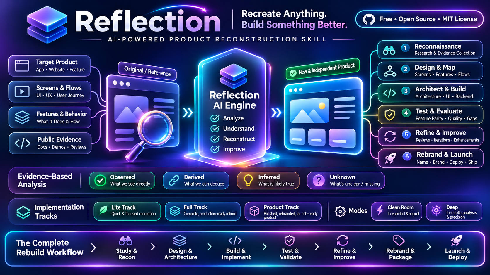
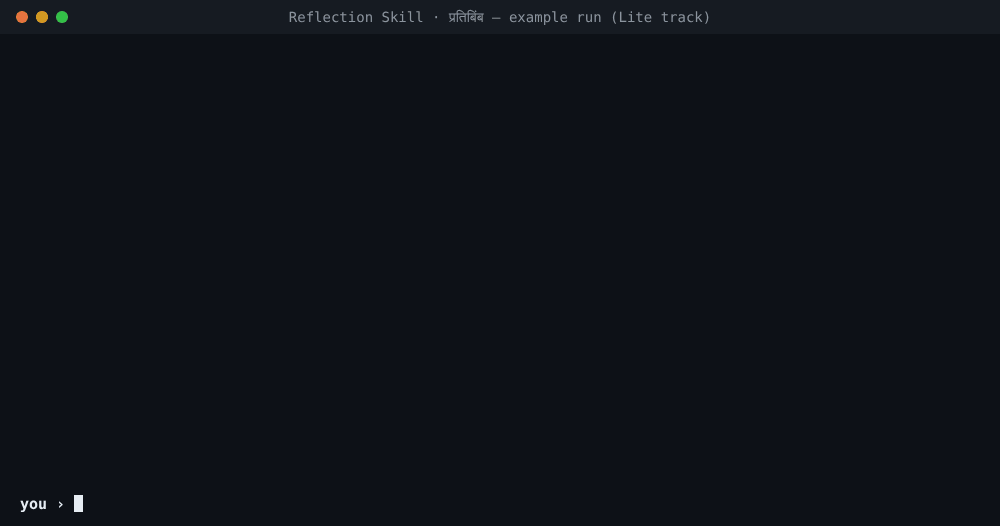

# Reflection Skill · प्रतिबिंब — हिंदी गाइड

> English: [README.md](README.md)



[](https://github.com/i-smiling-buddha/reflection-skill/stargazers)
[](LICENSE)
[](https://skills.sh/)
[](#यह-skill-किन-नियमों-पर-चलती-है)
[](https://skills.sh/i-smiling-buddha/reflection-skill)

**कुछ भी recreate कीजिए। उससे बेहतर बनाइए।**

*काम original जैसा। पर original की copy कभी नहीं।*

किसी app, website, game या software का अपना version बनाना है? यह open-source Agent Skill आपके AI agent को सिखाती है कि वह उसे बाहर से study करे, हर screen, flow और data table को map करे, और फिर आपके अपने brand के साथ उससे बेहतर version बनाए। हर finding पर **OBSERVED**, **DERIVED**, **INFERRED** या **UNKNOWN** का label लगता है, ताकि आपको हमेशा पता रहे कि क्या सच में देखा गया और क्या अंदाज़ा है।

Idea validate करने वाले founders, अच्छा build spec चाहने वाले vibe coders, competitor का UX समझने वाली product teams, और अपना पुराना tool दोबारा बनाने वालों के लिए उपयोगी।



<sub>Lite track session का एक उदाहरण — असली recorded run नहीं।</sub>

## Install

Open Agent Skills CLI से install करें:

```bash
npx skills add i-smiling-buddha/reflection-skill
```

पूछे जाने पर अपना target agent चुनें। पूरे ecosystem के लिए [Skills directory](https://skills.sh/) देखें।

**Claude Code plugin:**

```
/plugin marketplace add i-smiling-buddha/reflection-skill
/plugin install reflection-skill@reflection-skill
```

**Manual:** `skills/reflection` folder को अपने agent के skills folder में copy करें (`~/.claude/skills/`, या Codex, Copilot, Gemini CLI और Cursor के लिए `.agents/skills/`)।

## यह क्या करती है

| Track | आप क्या देते हैं | आपको क्या मिलता है |
|---|---|---|
| **Lite** (कुछ install नहीं) | Screenshots, screen recordings या public pages | Checklist, findings table, data model, और **"Build this"** spec जो Base44, Lovable, Claude या ChatGPT में सीधे paste हो सके |
| **Full** | Target और goal | Recon → architecture → design tokens → build → backend → tests → parity score → refine loop |
| **Product** | ऐसा target जिसका बेहतर version आप बेचना चाहते हैं | Full के साथ असली reviews का analysis, fix plan, positioning, rebrand, landing page, store listing और gated deploy |

| Phase | क्या होता है |
|---|---|
| **Recon** | Sources table, screen inventory (S01…), user flows (F01…) click count के साथ, components, अनुमानित data model, feature matrix, क्या clone नहीं हो सकता, और ईमानदार size |
| **Architect और design** | Simple managed stack, access rules वाला असली SQL schema, हर flow की API, screenshots से नापे गए design tokens, WCAG contrast |
| **Build और test** | App shell → core loop का vertical slice → हर screen हर state के साथ; Playwright tests, edge cases, severity के हिसाब से bugs |
| **Check** | Weighted feature-parity score, 390 / 768 / 1440 px पर layout diff (colour को ignore करके), behaviour diff, shippable / not-shippable फ़ैसला |
| **Entrepreneur** | 100+ असली, linked reviews से: users को क्या पसंद नहीं, क्या missing है, क्या unsolved है → fix plan और positioning |
| **Brand, launch, deploy** | Trademark checks के साथ नया नाम, palette, logo brief, voice, leftover sweep, landing page, pricing, store listing, preflight gate |

### दो modes

- **Clean room** (default): सिर्फ वही इस्तेमाल होता है जो एक आम user को दिखता है।
- **Deep**: [REA](https://github.com/morluto/rea) या [Craft Anything](https://github.com/storytold/craft-anything) tools से shipped artifact (binary, APK, ASAR, JS bundle, firmware) के अंदर भी पढ़ता है — सिर्फ आपके अपने software, open source, या जहाँ licence और कानून इजाज़त दें। Findings से behaviour समझा जाता है; decompiled code या assets आपकी build में नहीं जाते।

## उदाहरण

अपने AI agent से पूछें:

- “इस app का booking flow recreate करो। Lite track, ये रहे मेरे screenshots।”
- “इस website की हर screen और flow map करो और build spec दो।”
- “इस game का gameplay web game के रूप में बनाओ, फिर original से compare करो।”
- “इस app के users को क्या पसंद नहीं? Reviews पढ़कर gap ढूँढो।”
- “मेरा clone original के कितना करीब है? Parity score दो।”
- “मेरे version का नाम और brand बदलो ताकि original का कुछ न बचे।”

काम आपके project के `recreate/` folder में save होता है (brief, plan, evidence ledger, handoff, recon map, `features.csv`), ताकि लंबा काम बाद में कोई भी agent आगे बढ़ा सके।

## Compatibility

यह repository open [Agent Skills format](https://agentskills.io/) follow करती है। यह Claude, Claude Code, OpenAI Codex, GitHub Copilot, Gemini CLI और Cursor जैसे compatible agents में काम करती है। Support और install की जगह tool के हिसाब से अलग हो सकती है।

जिस chat app में skill loader नहीं है, वहाँ `skills/reflection/SKILL.md` को chat की शुरुआत में paste करें। Lite track ऐसे पूरा चलता है; build, test और Deep mode के लिए code चलाने वाला agent चाहिए, और Deep mode के लिए REA या Craft Anything tools भी connected होने चाहिए।

## यह skill किन नियमों पर चलती है

- सिर्फ public sources और आपका अपना account। Login, paywall या CAPTCHA bypass नहीं, scraping नहीं, original पर load-testing नहीं।
- Features और flows दोबारा बनते हैं; code, assets, logo, नाम, copy, colours या content कभी नहीं।
- सिर्फ official public APIs, आपकी अपनी keys के साथ।
- नकली reviews, quotes, numbers या check results नहीं। जो check चला ही नहीं, उस पर "to run" लिखा जाता है।
- Accounts और पैसे का काम आप खुद करते हैं। आपकी मंज़ूरी के बिना कुछ live नहीं होता, और rebrand sweep clean होने से पहले तो बिल्कुल नहीं।
- धोखा देने वाले look-alikes, gambling apps, या किसी आम इंसान को नुकसान पहुँचाने वाला कुछ भी नहीं।

## ज़रूरी सीमाएँ

- **"Perfect" clone की guarantee नहीं।** नतीजा target की complexity पर depend करता है। Booking tool कुछ हफ़्तों का काम है; spreadsheet engine नहीं। Recon पहले ईमानदारी से size बताता है।
- **Licensed content और networks clone नहीं हो सकते।** Music app का player बना सकते हैं, उसकी songs library नहीं।
- **Layout और parity scores guide हैं**, quality का सबूत नहीं। Screens खुद भी देखें।
- **Trademark और domain checks सिर्फ screening हैं**, legal clearance नहीं।
- **Deep mode के लिए extra tools चाहिए** (REA या Craft Anything), और यह सिर्फ उसी software के लिए है जिसे analyse करने की आपको इजाज़त हो।

**Legal note:** यह general जानकारी है, legal advice नहीं। अगर पैसा दाँव पर है, तो launch से पहले trademark/IP lawyer से check करवाएँ।

## Credits

Reflection चार MIT-licensed projects के तरीकों को मिलाकर नए सिरे से लिखी गई है। इनके authors का धन्यवाद:

- **[REA](https://github.com/morluto/rea)** by morluto — evidence-first reverse-engineering method
- **[Craft Anything](https://github.com/storytold/craft-anything)** by ArtCraft team — Study → Build → Check → Ready loop और Clean room / Deep modes
- **[Replica skill](https://github.com/Jakeschincariol/replica-skill)** by Jake Schincariol — recon से deploy तक की pipeline
- **"Reverse engineer Apps (no install)"** — REA के method का एक public Notion version

पूरे licence texts: [THIRD_PARTY_NOTICES.md](THIRD_PARTY_NOTICES.md)।

## Smiling Buddha की और free skills

- **[Smart Model Router Skill](https://github.com/i-smiling-buddha/smart-model-router-skill)** — tokens और API credits बचाइए: आपका agent हर coding task को उस सबसे सस्ते model पर भेजता है जो उसे भरोसे से कर सके, result verify करता है, और fail होने पर ही बड़े model पर जाता है। `npx skills add i-smiling-buddha/smart-model-router-skill`
- **[AI Image Recognition Skill](https://github.com/i-smiling-buddha/ai-image-recognition-skill)** — preview से अंदाज़ा मत लगाइए: आपका agent असली image file में transparency (नकली checkerboard पकड़ता है), असली format, size/DPI, colors, blur और GPS metadata check करता है। `npx skills add i-smiling-buddha/ai-image-recognition-skill`

## Contributing

Issues, bug reports, recreation के असली अनुभव और pull requests का स्वागत है। Public issues में passwords, API keys, private screenshots या किसी और company का code कभी paste न करें। Guidelines के लिए [CONTRIBUTING.md](CONTRIBUTING.md) देखें।

## License

MIT. Made by [Smiling Buddha](https://github.com/i-smiling-buddha) · [DESITechnology](https://desitechnology.com).
