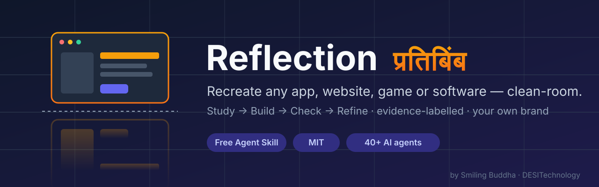

# Reflection Skill · प्रतिबिंब



[](https://github.com/i-smiling-buddha/reflection-skill/stargazers)
[](LICENSE)
[](https://skills.sh/)
[](#the-rules-it-enforces)
[](https://skills.sh/i-smiling-buddha/reflection-skill)

**Like the original in what it does. Never the original itself.**

हिंदी गाइड: **[README.hi.md](README.hi.md)**

Want your own version of an app, website, game or piece of software? This open-source Agent Skill teaches your AI agent to study it from the outside, map every screen, flow and data table, then build a better version under your own brand. Every finding is labelled **OBSERVED**, **DERIVED**, **INFERRED** or **UNKNOWN**, so you always know what was seen and what was guessed.

Useful for founders validating an idea, vibe coders who want a solid build spec, product teams studying a competitor's UX, and anyone rebuilding an old tool they own.

## Install

Install with the open Agent Skills CLI:

```bash
npx skills add i-smiling-buddha/reflection-skill
```

Choose your target agent when prompted. See the [Skills directory](https://skills.sh/) for the wider ecosystem.

**Claude Code plugin:**

```
/plugin marketplace add i-smiling-buddha/reflection-skill
/plugin install reflection-skill@reflection-skill
```

**Manual:** copy the `skills/reflection` folder into your agent's skills folder (`~/.claude/skills/`, or `.agents/skills/` for Codex, Copilot, Gemini CLI and Cursor).

## What it does

| Track | You give it | You get |
|---|---|---|
| **Lite** (no install) | Screenshots, screen recordings or public pages | A checklist, a findings table, the data model, and a **"Build this"** spec ready to paste into Base44, Lovable, Claude or ChatGPT |
| **Full** | A target and a goal | Recon → architecture → design tokens → build → backend → tests → parity score → refine loop |
| **Product** | A target you want to sell a better version of | Full, plus real-review analysis, a fix plan, positioning, rebrand, landing page, store listing and a gated deploy |

| Phase | What happens |
|---|---|
| **Recon** | Sources table, screen inventory (S01…), user flows (F01…) with click counts, components, inferred data model, feature matrix, what cannot be cloned, honest size |
| **Architect & design** | Boring managed stack, real SQL schema with access rules, API per flow, design tokens measured from screenshots, WCAG contrast |
| **Build & test** | App shell → core-loop vertical slice → every screen with every state; Playwright tests, edge cases, bugs by severity |
| **Check** | Weighted feature-parity score, layout diff at 390 / 768 / 1440 px that ignores colour, behaviour diff, a shippable / not-shippable verdict |
| **Entrepreneur** | 100+ real, linked reviews ranked into what users hate, what is missing and what is unsolved → fix plan and positioning |
| **Brand, launch, deploy** | New name with trademark checks, palette, logo brief, voice, a leftover sweep, landing page, pricing, store listing, preflight gate |

### Two modes

- **Clean room** (default): works only from what a normal user can see.
- **Deep**: also reads inside a shipped artifact (binary, APK, ASAR, JS bundle, firmware) through [REA](https://github.com/morluto/rea) or [Craft Anything](https://github.com/storytold/craft-anything) tools, only for your own software, open source, or where the licence and law allow it. Findings inform behaviour; no decompiled code or assets go into your build.

## Example tasks

Ask your AI agent:

- “Recreate this app's booking flow. Lite track, here are my screenshots.”
- “Map every screen and flow of this website and give me a build spec.”
- “Rebuild this game's gameplay as a web game, then check it against the original.”
- “What do users hate about this app? Read the reviews and find the gap.”
- “How close is my clone to the original? Give me the parity score.”
- “Name and rebrand my version so nothing of the original is left.”

Work is kept in a `recreate/` folder in your project (brief, plan, evidence ledger, handoff, recon map, `features.csv`), so a long job can be resumed later by any agent.

## Compatibility

This repository follows the open [Agent Skills format](https://agentskills.io/). It works in compatible agents such as Claude, Claude Code, OpenAI Codex, GitHub Copilot, Gemini CLI and Cursor. Exact support and installation locations vary by tool.

For a chat app without a skill loader, paste `skills/reflection/SKILL.md` at the top of the chat. The Lite track works fully this way; building, testing and Deep mode need an agent with code execution, and Deep mode also needs the REA or Craft Anything tools connected.

## The rules it enforces

- Public sources and your own account only. No bypassing logins, paywalls or CAPTCHAs, no scraping, no load-testing the original.
- Rebuild features and flows, never code, assets, logos, names, copy, colours or content.
- Official public APIs with your own keys only.
- No invented reviews, quotes, numbers or check results. A check nobody ran is marked "to run".
- You create accounts and handle money. Nothing goes live without your go, and never before the rebrand sweep is clean.
- No deceptive look-alikes, gambling apps, or anything that harms a private person.

## Important limitations

- **No guarantee of a "perfect" clone.** Results depend on how complex the target is. A booking tool is weeks; a spreadsheet engine is not. Recon sizes it honestly first.
- **Licensed content and networks can't be cloned.** You can rebuild a music app's player, not its catalogue.
- **Layout and parity scores are guides**, not proof of quality. Review the screens yourself.
- **Trademark and domain checks are screening only**, not legal clearance.
- **Deep mode needs extra tools** (REA or Craft Anything) and is for software you are allowed to analyse.

**Legal note:** this is general information, not legal advice. If money is on the line, have a trademark/IP lawyer check your product before launch.

## Credits

Reflection is an original rewrite that merges the methods of four MIT-licensed works. Thank you to their authors:

- **[REA](https://github.com/morluto/rea)** by morluto — the evidence-first reverse-engineering method
- **[Craft Anything](https://github.com/storytold/craft-anything)** by the ArtCraft team — the Study → Build → Check → Ready loop and Clean room / Deep modes
- **[Replica skill](https://github.com/Jakeschincariol/replica-skill)** by Jake Schincariol — the recon-to-deploy pipeline
- **"Reverse engineer Apps (no install)"** — a public Notion distillation of REA's method

Full licence texts: [THIRD_PARTY_NOTICES.md](THIRD_PARTY_NOTICES.md).

## More free skills by Smiling Buddha

- **[Smart Model Router Skill](https://github.com/i-smiling-buddha/smart-model-router-skill)** — save tokens and API credits: your agent routes each coding task to the cheapest model that can reliably do it, verifies the result, and escalates only when it fails. `npx skills add i-smiling-buddha/smart-model-router-skill`
- **[AI Image Recognition Skill](https://github.com/i-smiling-buddha/ai-image-recognition-skill)** — stop guessing from previews: your agent checks real transparency (catches fake checkerboards), true format, size/DPI, colors, blur and GPS metadata in the actual image file. `npx skills add i-smiling-buddha/ai-image-recognition-skill`

## Contributing

Issues, bug reports, real-world recreation stories and pull requests are welcome. Please never paste passwords, API keys, private screenshots or another company's code in public issues. See [CONTRIBUTING.md](CONTRIBUTING.md) for guidelines.

## License

MIT. Made by [Smiling Buddha](https://github.com/i-smiling-buddha) · [DESITechnology](https://desitechnology.com).
